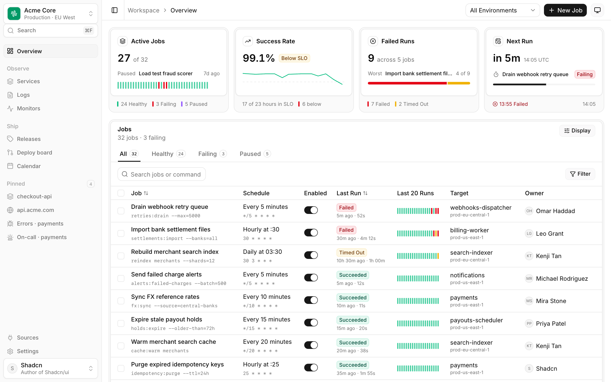
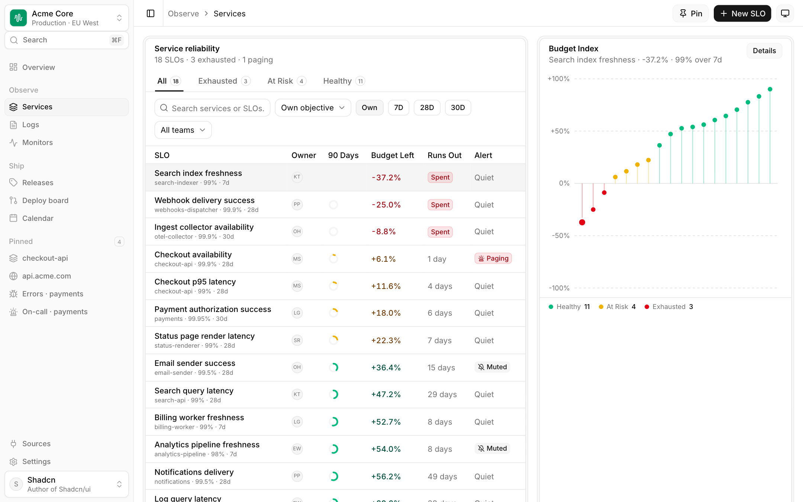
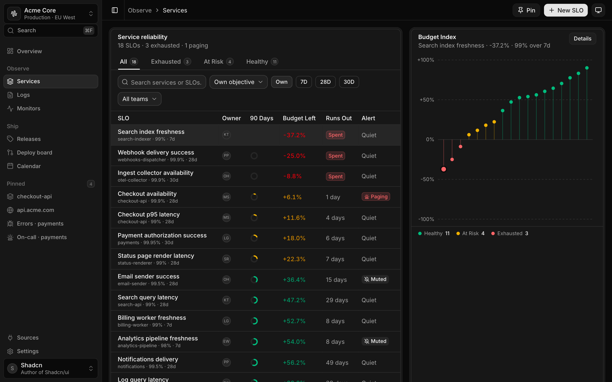
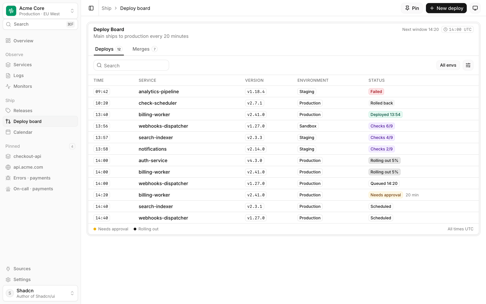
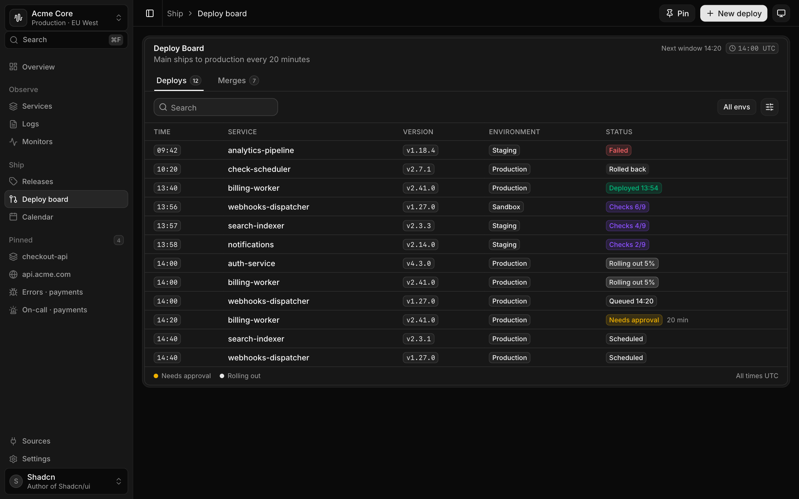

<div align="center">

# Moonlight UI

**A dense, quiet, dashboard-grade design system for React.**<br />
shadcn/ui on Base UI and Tailwind v4, distributed as a private shadcn registry.


[Quick start](#quick-start) · [Components](#components) · [Design language](#design-language) · [Use with AI](#use-with-ai) · [Publishing](#publishing-the-registry) · [Development](#development)

<br />

<picture>
  <source media="(prefers-color-scheme: dark)" srcset="docs/assets/overview-dark.png" />
  
</picture>

</div>

<br />

## Why Moonlight

Stock shadcn is a great starting point and a poor finishing point: every project ends up re-theming the same primitives and
drifting a little further from the last one. Moonlight is that finishing work, done once.

- **One look, every project.** Tokens, density and component variants are defined in a single place and installed with one command.
- **You own the code.** Components are copied into your project as source, like any shadcn component. There is no runtime package to version-lock or fight.
- **Built for dense product UI.** 13px text, `h-8` controls, tinted status badges, tables and trees that stay legible at a glance. Not a marketing kit.
- **Light and dark from day one.** Every token has both values; nothing is hard-coded.
- **Agent-ready.** The registry ships a machine-readable catalog and a Claude Code skill, so AI assistants build with Moonlight instead of inventing primitives.

## Quick start

> Replace `<REGISTRY_URL>` with the base URL where `public/r` is hosted, for example `https://ui.yourdomain.com/r`.
> See [Publishing the registry](#publishing-the-registry).

### New project

One command creates a Next.js app with the theme, every component, a root layout (Inter and the theme script) and a sample page.

```bash
npx shadcn@latest init -d -n my-app <REGISTRY_URL>/moonlight-starter.json
```

### Existing shadcn project

Requires Next.js with Tailwind v4 and a `components.json`.

```bash
# 1. Theme tokens: palette, radius, status colors, light and dark.
#    --overwrite is required, otherwise your existing token values win and Moonlight never applies.
npx shadcn@latest add <REGISTRY_URL>/moonlight-theme.json --overwrite --yes

# 2. Components: everything...
npx shadcn@latest add <REGISTRY_URL>/moonlight.json --yes

#    ...or just what you need. Dependencies come along automatically.
npx shadcn@latest add <REGISTRY_URL>/button.json <REGISTRY_URL>/badge.json --yes
```

### Shorter commands with a namespace

Register the registry once in the consuming project's `components.json`:

```json
{
  "registries": {
    "@moonlight": "<REGISTRY_URL>/{name}.json"
  }
}
```

```bash
npx shadcn@latest add @moonlight/button @moonlight/frame @moonlight/data-grid
```

## Components

35 UI primitives plus app-shell templates. Each is its own registry item, so installs stay minimal.

| Area | Components |
| --- | --- |
| **Surfaces** | `frame` · `card` · `sheet` · `popover` · `hover-card` · `separator` · `scroll-area` |
| **Actions** | `button` · `toggle` · `toggle-group` · `dropdown-menu` |
| **Forms** | `input` · `input-group` · `textarea` · `select` · `checkbox` · `switch` · `field` · `label` |
| **Data** | `table` · `data-grid` (TanStack Table, virtualized rows, drag and drop, column filters) · `tree` · `chart` · `progress` |
| **Feedback** | `badge` · `skeleton` · `spinner` · `tooltip` · `kbd` |
| **Navigation** | `sidebar` · `tabs` · `breadcrumb` |
| **Content** | `avatar` · `item` · `icon-tile` |

**App shell** templates, installed as editable source: `moonlight-app-sidebar`, `moonlight-page-header`,
`moonlight-page-body`, `moonlight-theme-toggle`, `moonlight-range-toggle`, `moonlight-run-strip`.

**Meta items**: `moonlight-theme` (tokens only), `moonlight` (theme and all components; never touches your layout or pages),
`moonlight-starter` (everything plus `app/layout.tsx` and `app/page.tsx`, for new projects only).

### A taste of the API

```tsx
import { Frame, FramePanel, FrameHeader, FrameTitle, FrameDescription } from "@/components/ui/frame"
import { Badge } from "@/components/ui/badge"
import { Button } from "@/components/ui/button"

export function Deploys() {
  return (
    <Frame>
      <FramePanel>
        <FrameHeader>
          <FrameTitle>Deploy board</FrameTitle>
          <FrameDescription>Main ships to production every 20 minutes</FrameDescription>
        </FrameHeader>
        <Badge variant="success-light">Deployed</Badge>
        <Badge variant="warning-light">Needs approval</Badge>
        <Button variant="muted" size="sm">Filter</Button>
      </FramePanel>
    </Frame>
  )
}
```

## Design language

|  |  |
| --- | --- |
| **Typeface** | Inter |
| **Density** | 13 to 14px text, `h-8` controls, compact rows |
| **Radius** | `0.625rem` |
| **Palette** | Neutral, with semantic `success`, `info`, `warning`, `destructive`, `focus` and `invert` status colors |
| **Signature surface** | `Frame`: a muted outer shell holding white panels |
| **Status** | Tinted `*-light` badge variants rather than saturated fills |
| **Tabs** | `variant="line"`: a full-width underlined strip for page-level navigation |
| **Sidebar** | 15rem, muted 13px items with an inset ring on the active one |
| **Dark mode** | `.dark` class on `<html>`; handled by the theme toggle and an init script |

Only semantic tokens are used (`bg-background`, `bg-card`, `bg-muted`, `text-foreground`, `text-muted-foreground`, `border`, `ring`).
No raw hex values and no `bg-gray-*`, which is what keeps theming a one-file change.

<table>
  <tr>
    <td width="50%"></td>
    <td width="50%"></td>
  </tr>
  <tr>
    <td width="50%"></td>
    <td width="50%"></td>
  </tr>
</table>

## Use with AI

Moonlight is designed to be built against by coding agents. The build step generates two artifacts:

| Artifact | Purpose |
| --- | --- |
| `public/r/llms.txt` | Usage rules plus a catalog of every component with its exports and variants |
| `moonlight/skill/moonlight/SKILL.md` | A Claude Code skill that tells the agent to use Moonlight instead of stock shadcn |

Install the skill once and it applies to every project:

```bash
mkdir -p ~/.claude/skills && cp -R moonlight/skill/moonlight ~/.claude/skills/
```

The hand-written source of the rules is [`moonlight/AI-GUIDE.md`](moonlight/AI-GUIDE.md).

## Publishing the registry

`public/r/*.json` is generated from the component source, so it cannot drift from what the demo app renders.
The registry's base URL is baked into the output because items reference each other by URL, so build with the URL you will serve from:

```bash
REGISTRY_URL=https://ui.yourdomain.com/r npm run registry:build
```

Then deploy `public/` as static files (Vercel, Cloudflare Pages, GitHub Pages). To use the registry locally:

```bash
npm run registry:build   # defaults to http://localhost:4111/r
npm run registry:serve   # serves public/ on :4111
```

To keep the registry private, put it behind Vercel password protection or Cloudflare Access, or use shadcn's
[registry authentication headers](https://ui.shadcn.com/docs/registry/authentication).

### Updating consumers

Components are copied, so updates are explicit. Re-run `add ... --overwrite` in a project to pull in changes, and review the diff.

## Repository layout

```text
components/
  ui/            Moonlight primitives (source of truth for the registry)
  app/           App-shell templates: sidebar, page header and body, theme toggle
  <feature>/     Demo-app view components (overview, services, logs, monitors, ...)
app/
  globals.css    Design tokens, light and dark
  (shadcn)/      Reference app composed only from components/ui
lib/ hooks/      Utilities and sample data
registry/
  starter/       Files shipped by the moonlight-starter item
moonlight/
  build-registry.mjs   Generates registry.json, public/r/*, llms.txt and the Claude skill
  AI-GUIDE.md          Hand-written rules for AI assistants
  scripts/             Tooling (README screenshots)
docs/assets/     README images
```

## Development

```bash
npm install
npm run dev              # reference app at http://localhost:3000
npm run typecheck
npm run build
npm run registry:build   # regenerate public/r, llms.txt and the Claude skill
npm run docs:screenshots # refresh docs/assets (needs the dev server and Chrome; see moonlight/scripts/screenshots.mjs)
```

The reference app implements the Overview, Services, Logs, Monitors, Deploy board and Calendar pages using only
`components/ui`, with no hand-written primitives. Treat it as the living test suite for the library: if a page needs
something that is not in `components/ui`, that component belongs in the library.

### Adding or changing a component

1. Edit or add `components/ui/<name>.tsx`. Keep a JSDoc block at the top describing the intent and variants.
2. Use semantic tokens only; verify both light and dark.
3. Run `npm run registry:build`. New files in `components/ui` become registry items automatically.
4. Commit the source, then redeploy `public/`.

## Built on

[shadcn/ui](https://ui.shadcn.com) (MIT) · [Base UI](https://base-ui.com) (MIT) · [Tailwind CSS](https://tailwindcss.com) ·
[TanStack Table](https://tanstack.com/table) and [Virtual](https://tanstack.com/virtual) · [Recharts](https://recharts.org) ·
[dnd kit](https://dndkit.com) · [Lucide](https://lucide.dev) · [Sonner](https://sonner.emilkowal.ski)

Parts of the visual language (Frame, IconTile, badge variants, data grid) derive from [ReUI](https://reui.io) and the Strata demo.

## License

Private and proprietary. All rights reserved. Third-party components retain their original licenses; confirm the ReUI terms
before making this repository or its registry public.
